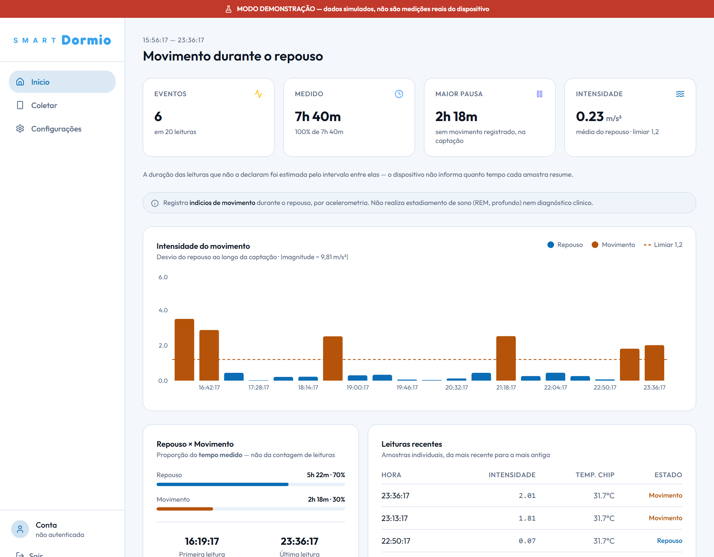
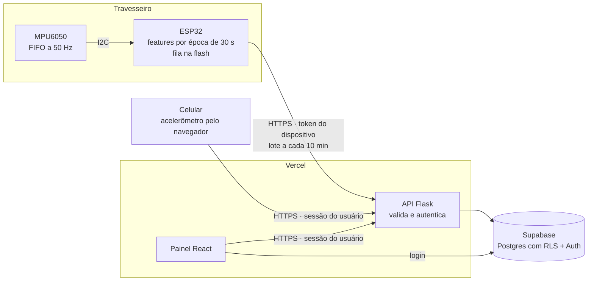

# 🌙 Smart Dormio

[](https://github.com/vitormendes4072/DormioSmart/actions/workflows/ci.yml)


Dispositivo embarcado de **baixo consumo**, instalado **dentro do travesseiro**, que registra
**movimento durante o repouso** sem contato com o corpo. Na arquitetura adotada, um ESP32 lê
em rajadas a memória interna (FIFO) de um MPU6050 a 50 Hz, calcula por época de 30 s as
características que um modelo de sono × vigília consome, e envia os dados para uma aplicação web
que os guarda e mostra. *(O firmware dessa arquitetura ainda não rodou na placa — ver o estado abaixo.)*
Trabalho de Conclusão de Curso em Engenharia da Computação (Centro Universitário Senac, 2026).

> **Escopo (honesto):** o projeto registra indícios de movimento, ancorados em actigrafia.
> **Não** faz estadiamento de sono (REM/profundo), **não** faz diagnóstico clínico e **não**
> substitui polissonografia.

## 🔗 Demo

Aplicação em produção: **https://dormio-smart.vercel.app** — página inicial, cadastro,
painel, coleta pelo celular e a [política de privacidade](https://dormio-smart.vercel.app/privacidade).



*O painel real, com **dados sintéticos** do modo demonstração (`frontend/src/lib/demo.ts`), que
só existe no servidor de desenvolvimento e põe a faixa vermelha em toda captura — nenhuma
medição de pessoa aparece aqui. Capturado em 03/11/2026.*

## 📌 Estado do projeto — em 03/11/2026

| Parte | Estado |
|---|---|
| **Aplicação web** | ✅ No ar. Contas com isolamento por dono (RLS no Postgres), pareamento de dispositivos com token próprio, ingestão validada (leitura única e em lote), painel com sessões e lacunas, perfil, exportação dos dados em CSV e exclusão da conta (LGPD) e política de privacidade. |
| **Coleta pelo celular** | ✅ No ar (`/coletar`): o acelerômetro do próprio celular, pelo navegador, alimenta o mesmo caminho do dispositivo. |
| **Firmware** | 🟡 **Escrito e testado no computador, não na placa.** A arquitetura C2 (sono leve, FIFO a 50 Hz, features por época, fila na flash, envio em lote a cada 10 min) foi decidida em 30/10 ([`ARQ-01`](docs/DECISAO-ARQ-01-CADENCIA.md)). O núcleo em C++ roda nos testes do host; o `sketch.ino` nunca rodou num ESP32. Fase 1 validada em simulação no Wokwi. |
| **Protótipo físico** | ⏳ Espera a solda. Depois dela: calibração, teste de bancada e a primeira noite real. |
| **Modelo de sono × vigília** | ✅ Bloco de ML fechado: pipeline reprodutível, baselines, matriz de transferência entre posições do sensor e validação em coorte independente. Resultados em [`docs/RESULTADOS-TCC.md`](docs/RESULTADOS-TCC.md). |
| **Validação clínica** | ⚠️ Nenhuma. É um projeto acadêmico. |

O que está pendente, e o que trava o quê, está em
[`docs/BACKLOG-COMPLETO.md`](docs/BACKLOG-COMPLETO.md). O que foi feito — inclusive o que deu
errado — está no [diário de engenharia](docs/DIARIO-DE-ENGENHARIA.md).

## 🧩 Arquitetura



O diagrama completo, com arquivos, funções e o que ainda não foi exercitado, está em
[`docs/diagramas/DIAG-01-arquitetura.md`](docs/diagramas/DIAG-01-arquitetura.md). O formato de cada
leitura está no [contrato de dados](docs/DATA-CONTRACT.md).

## 🔌 API

| Rota | Credencial | O que faz |
|---|---|---|
| `GET /health` | nenhuma | `200` com o banco alcançável; `503` se não |
| `POST /api/data` | token do dispositivo, ou sessão (celular) | Grava uma leitura |
| `POST /api/data/lote` | token do dispositivo, ou sessão (celular) | Grava até 60 leituras, com o resultado de cada uma |
| `GET /api/sleep-history` | sessão | Leituras recentes, para o painel |
| `GET /api/features` | sessão | As 8 features por época de uma janela de até 24 h |
| `GET /api/devices` · `POST /api/devices` | sessão | Lista e pareia dispositivos (o token aparece uma vez) |
| `POST /api/devices/celular` | sessão | O dispositivo "celular" do usuário, criado se não houver |
| `PATCH /api/devices/<id>` · `POST /api/devices/<id>/revogar` | sessão | Renomeia e revoga |
| `GET /api/me/perfil` · `PATCH /api/me/perfil` | sessão | Lê e corrige o perfil |
| `DELETE /api/me` | sessão | Apaga a conta e os dados |

Detalhes em [`web-app/README.md`](web-app/README.md).

## 🗂️ Estrutura

```
firmware/    # ESP32 + MPU6050: sketches e o núcleo em C++ puro (firmware/nucleo/), testado no host
web-app/     # API Flask: ingestão, autenticação, validação; migrações do banco e testes (inclusive RLS)
frontend/    # React + TypeScript + Vite: página inicial, painel, coleta pelo celular, configurações
ml/          # pipeline de sono × vigília: dados públicos, experimentos e testes
scripts/     # conferências que rodam no CI (cálculos, documentos, backlog, TLS do firmware, produção)
docs/        # backlog, diário, lições, limitações, decisões, contrato de dados, diagramas
img/         # imagens do README e dos READMEs das pastas
.github/     # CI e monitores (saúde da produção, auditoria de dependências)
vercel.json  # roteamento: /api e /health para o Flask, o resto para o frontend
```

## 🛠️ Stack
**Firmware:** C++ · Arduino · ESP32 · MPU6050 · Wokwi  
**Backend:** Python 3.11 · Flask · Supabase (PostgreSQL + Auth, com RLS) · Vercel  
**Frontend:** React 18 · TypeScript · Vite · Tailwind CSS · Recharts · React Router  
**ML:** Python 3.11 · numpy · pandas · scipy · scikit-learn  
**Qualidade:** pytest · vitest · GitHub Actions (CI)

## ▶️ Como rodar

Pré-requisitos: Python 3.11, Node 22 e um projeto no [Supabase](https://supabase.com) com as
migrações de [`web-app/migrations/`](web-app/migrations/README.md) aplicadas. Sem as chaves, a
aplicação sobe, mas não conecta ao banco (o `/health` responde `503`).

**Backend** (http://localhost:5000):
```bash
cp web-app/.env.example web-app/.env   # preencha SUPABASE_URL, SUPABASE_ANON_KEY e SUPABASE_INGESTAO_KEY
pip install -r web-app/requirements.txt
python web-app/app.py
```
A `SUPABASE_INGESTAO_KEY` não sai pronta do painel do Supabase: ver
[`web-app/README.md`](web-app/README.md#rotação-da-chave-de-ingestão). O próprio `.env.example`
explica cada variável.

**Frontend** (http://localhost:5173; as chamadas a `/api` vão para o backend local):
```bash
cp frontend/.env.example frontend/.env   # preencha VITE_SUPABASE_URL e VITE_SUPABASE_ANON_KEY
cd frontend
npm ci
npm run dev
```

**Testes** (cada linha a partir da raiz do repositório):
```bash
pip install pytest
cd web-app && python -m pytest tests/ --ignore=tests/rls   # backend, Supabase mockado
cd frontend && npm test                                     # frontend (vitest), depois do npm ci
pip install -r ml/requirements.txt && cd ml && python -m pytest testes   # ML
```
Há ainda a suíte de RLS contra um Postgres de verdade, os testes do núcleo do firmware (`make`
em `firmware/nucleo/`) e as conferências de documento — todos rodam no CI, e a tabela com os
comandos está no [`CLAUDE.md`](CLAUDE.md#testes).

### Testar sem hardware
O simulador da arquitetura C2 gera uma noite sintética no formato exato do firmware — épocas de
30 s com as seis características, em lotes para `/api/data/lote` — e a envia com o token de um
dispositivo pareado (Configurações → dispositivos). Precisa de numpy e scipy, então roda pelo
ambiente do `ml/`:
```bash
export DORMIO_DEVICE_TOKEN="<token>"    # Windows: $env:DORMIO_DEVICE_TOKEN="<token>"
python scripts/simulador_c2.py --seco   # só gera e resume, sem enviar
python scripts/simulador_c2.py          # a última noite já terminada, 23h–7h, no backend local
python scripts/simulador_c2.py --tempo-real   # uma época a cada 30 s, enviando a cada 10 min
```
Com `DORMIO_API_URL` (por exemplo, `https://dormio-smart.vercel.app`), envia para outra base. O
sinal é sintético: serve para a corrente funcionar, e nada medido sobre ele é resultado. O
`web-app/fake_sensor.py`, mais antigo, simula o caminho de leitura avulsa (`/api/data`).
O firmware também pode ser aberto no [Wokwi](https://wokwi.com) — ver
[`firmware/README.md`](firmware/README.md).

## 📚 Documentação

| Documento | Para quê |
|---|---|
| [`docs/BACKLOG-COMPLETO.md`](docs/BACKLOG-COMPLETO.md) | O que está pendente, organizado por dependência |
| [`docs/DIARIO-DE-ENGENHARIA.md`](docs/DIARIO-DE-ENGENHARIA.md) | Registro cronológico, inclusive do que deu errado |
| [`docs/LICOES-APRENDIDAS.md`](docs/LICOES-APRENDIDAS.md) | Os padrões de falha que o projeto já mostrou |
| [`docs/LIMITACOES-TCC.md`](docs/LIMITACOES-TCC.md) | Os limites medidos do trabalho |
| [`docs/RESULTADOS-TCC.md`](docs/RESULTADOS-TCC.md) | Os resultados do bloco de ML |
| [`docs/DECISAO-ARQ-01-CADENCIA.md`](docs/DECISAO-ARQ-01-CADENCIA.md) | Por que a arquitetura de captação é a C2 |
| [`docs/DATA-CONTRACT.md`](docs/DATA-CONTRACT.md) | O formato de cada leitura, do firmware ao banco |
| [`docs/diagramas/`](docs/diagramas/README.md) | Arquitetura, esquemático, firmware, modelo de dados, pipeline de ML |
| [`docs/POLITICA-DE-PRIVACIDADE.md`](docs/POLITICA-DE-PRIVACIDADE.md) | A política publicada em `/privacidade` |
| [`docs/DEPLOY.md`](docs/DEPLOY.md) | Como a produção é publicada e conferida |

## 📄 Licença
Projeto acadêmico (Trabalho de Conclusão de Curso). Uso e distribuição conforme as normas do
Centro Universitário Senac — para reutilização, consulte os autores.

## 👥 Autores
Arthur Neves Vieira Ponzoni · Vitor Mendes Oliverio
