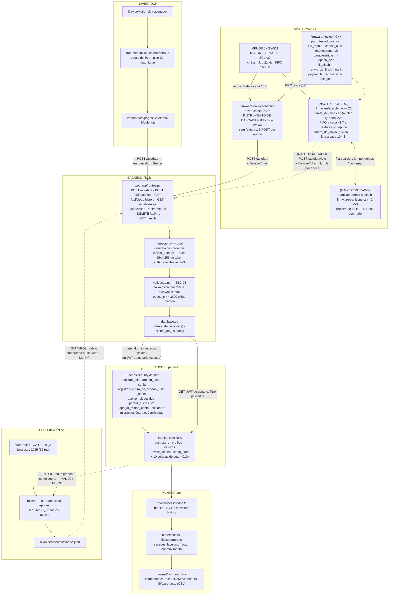

# DIAG-01 — Arquitetura do sistema, ponta a ponta

> **Item do backlog:** `DIAG-01` (escopo ampliado — o backlog pedia "diagrama de blocos
> da arquitetura"; aqui ele cobre sensor → firmware → API → banco → painel).
> **Onde entra no TCC:** capítulo de Desenvolvimento, primeira figura — é o mapa que
> todas as seções seguintes referenciam.
> **Estado do código:** verificado em `2026-09-29`, na branch `chore/GIT-01-normalizar-fim-de-linha`.
> ✏️ **Reconferido em `2026-10-28`** (`DIAG-01`): as 55 afirmações de arquivo, rota, função,
> tabela com RLS, pino e constante batem com o código. Entraram o que surgiu depois de 29/09 —
> as features em C++ (`filtro.h`, `caracteristicas.h`, **não exercitadas**), a rota
> `/api/me/perfil` (`PERFIL-01`) e o `/health` — e o `ML-04` da seta futura virou `ML-09`.
> ✏️ **Atualizado em `2026-10-31`** para a arquitetura C2: o bloco do dispositivo passou a ser o
> `sketch.ino` reescrito (`FW-07` (b)), com a fila na flash (`FW-08`) e o envio em lote; o
> banco ganhou as colunas da `010` e a rota `GET /api/features`. Identificadores conferidos
> contra o código por script, com controle positivo. **O `sketch.ino` não rodou na placa:** o
> bloco leva `(NÃO EXERCITADO)`.

## Convenções de leitura (valem para os quatro diagramas)

Nada aqui depende de cor. A informação é carregada por **forma**, **traço** e **texto**:

| Aparência | Significado |
|---|---|
| Caixa de traço **contínuo** | Existe no código de hoje e roda. |
| Caixa de traço **tracejado**, rótulo começando por `(FUTURO)` | Projetado, **não implementado**. O item do backlog está no rótulo. |
| Caixa de traço **contínuo** com rótulo `(NÃO EXERCITADO)` | O código existe, mas nunca rodou no cenário que o justifica. |
| Seta cheia `-->` | Chamada ou fluxo de dado que acontece hoje. |
| Seta tracejada `-.->` | Fluxo projetado, ou fluxo que só ocorre em caminho de exceção. |

---

## O diagrama

## Notas que o diagrama sustenta, e que precisam ser ditas no texto

1. **O classificador de ML não está no produto.** O bloco `ml/` é pesquisa offline. O
   rótulo `status` que chega ao banco é produzido por limiar no firmware
   (`firmware/nucleo/payload.h`: `|total − 9,81| > 1,2 m/s²` → `movimento`), não por
   modelo. As duas setas tracejadas entre `ml/` e o produto são projeto (`ML-INF`,
   `VAL-02`), não realidade.
2. **Há dois sketches, e o de produto ainda não rodou.** ✏️ *31/10:* o `sketch.ino` foi
   reescrito para a C2 (`FW-07` (b)) e compila e liga com o núcleo no host, mas nunca foi
   gravado na placa — por isso o bloco leva `(NÃO EXERCITADO)`. O `envio-continuo.ino`
   continua como instrumento de bancada e como o sketch que roda no Wokwi, que pode não
   simular a FIFO do MPU6050.
3. **O backend não escolhe o dono da linha.** `routes.py` monta o payload sem `user_id`
   e sem `device_id`; quem carimba é a função no banco, a partir do hash do token ou de
   `auth.uid()`. Ver `DIAG-04`.
4. **O ESP32 e o navegador são duas fontes com credenciais deliberadamente diferentes** —
   `X-Device-Token` para quem não tem sessão, `Authorization: Bearer` para quem tem.
   Ver `web-app/ingestao.py`.
5. **Nenhuma noite real foi captada ainda.** Os 8 pinos do MPU6050 não estão soldados
   (Etapa 0 do backlog). O caminho `MPU6050 → painel` está escrito e testado no host, não
   validado em uso noturno.
6. **`GET /api/features` não tem consumidor no painel.** ✏️ *31/10:* a rota existe e devolve
   as 8 features da noite, com `inclinacao_rel` e `d_angulo` derivadas no servidor; quem a
   consumirá é o modelo (`ML-INF`), e o painel não a chama.
