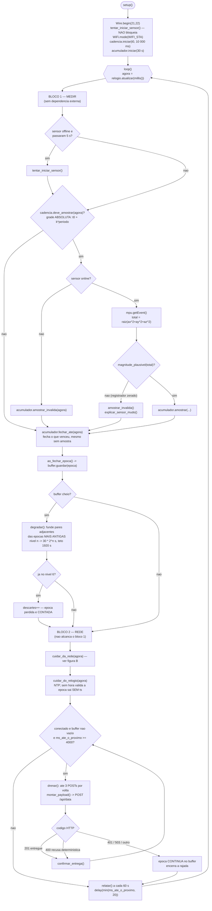
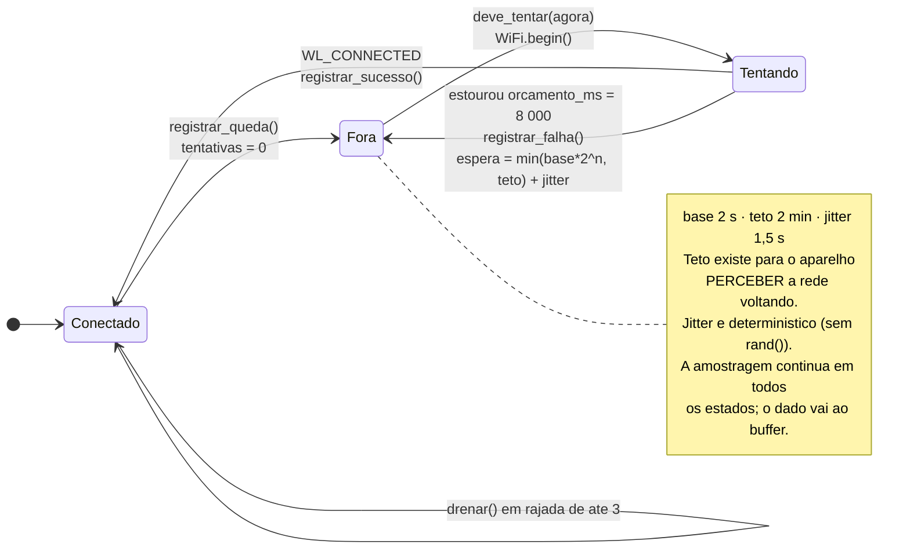
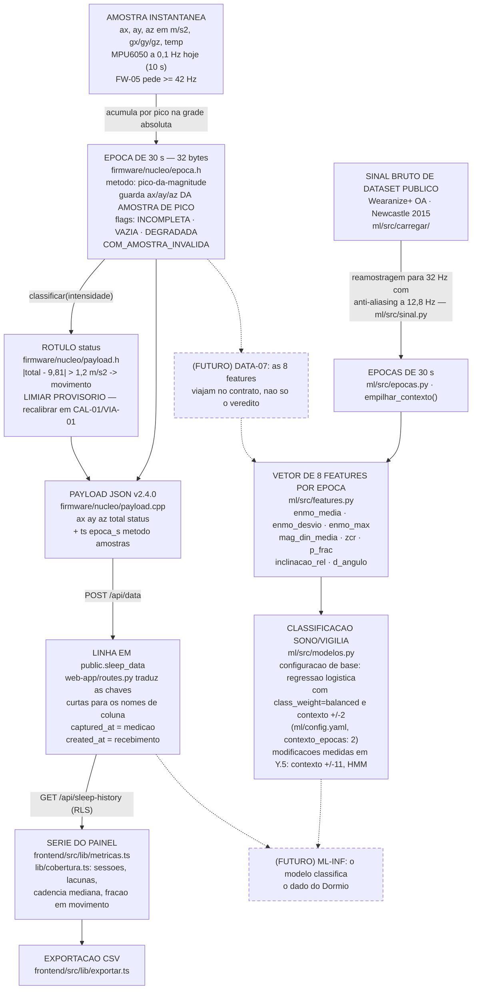

# DIAG-03 — Firmware: laço, política de rede e as transformações do dado

> **Item do backlog:** `DIAG-03` ("fluxograma do firmware / máquina de estados"), ampliado
> para cobrir também os pontos em que o dado muda de forma (amostra → época de 30 s →
> features → classificação), que o backlog não pedia explicitamente.
> **Onde entra no TCC:** capítulo de Desenvolvimento, seção de firmware (figuras A e B)
> e seção de tratamento do dado (figura C). A figura C também serve ao capítulo de
> Metodologia, como ponte para os resultados de ML.
> **Estado do código:** verificado em `2026-09-29`. As figuras A e B descrevem
> `firmware/envio-continuo/envio-continuo.ino` sobre `firmware/nucleo/`, que é o que
> roda hoje. `firmware/sketch.ino` **não** é descrito aqui: ele tira uma amostra por
> boot e a reescrita é o item aberto `FW-07`.

Convenções de leitura: ver `DIAG-01`.

---

## A — O laço principal (`envio-continuo.ino`)

A propriedade que o diagrama existe para mostrar: **o bloco 1 não depende do bloco 2**.
Nada na medição espera por rede, por serial ou pelo sensor estar vivo.

**Onde a época vazia entra.** Uma época sem nenhuma amostra sai marcada `EPOCA_VAZIA` e
**ocupa lugar no buffer** — custa 32 bytes dizer "aqui não houve medida". Ela não é
enviada (`ax/ay/az` são obrigatórios e inventá-los seria fabricar medida): `drenar()`
chama `confirmar_entrega()` e conta em `lacunas_puladas`. No banco a lacuna aparece como
o intervalo entre dois `ts`, que é o que ela é.

---

## B — A política de reconexão (`firmware/nucleo/reconexao.h`)

Esta é a máquina de estados propriamente dita. Ela responde a uma pergunta só — "já posso
tentar?" — e **nunca espera**: a espera vira consulta a relógio.

---

## C — Onde o dado muda de forma

Cada seta é uma transformação. O texto do TCC deve poder apontar para o arquivo que a
executa — por isso os nomes estão no diagrama.

## O ponto que este diagrama existe para deixar claro

Há **duas cadeias de transformação distintas**, e hoje elas não se tocam:

- A cadeia do **produto** vai de amostra a época a rótulo por **limiar fixo**
  (`|total − 9,81| > 1,2`), e termina no painel. Não há modelo nela.
- A cadeia da **pesquisa** vai de sinal de dataset público a época a **8 features** a
  classificador, e termina em JSON de experimento. Não há dado do Dormio nela.

As duas setas tracejadas (`DATA-07`, `ML-INF`) são exatamente o que falta para juntá-las,
e estão abertas no backlog. Afirmar na banca que "o Dormio usa aprendizado de máquina para
classificar sono" seria falso hoje; o que é verdade é que o pipeline de ML mediu o custo da
decisão de posicionamento do sensor que o Dormio adota.
