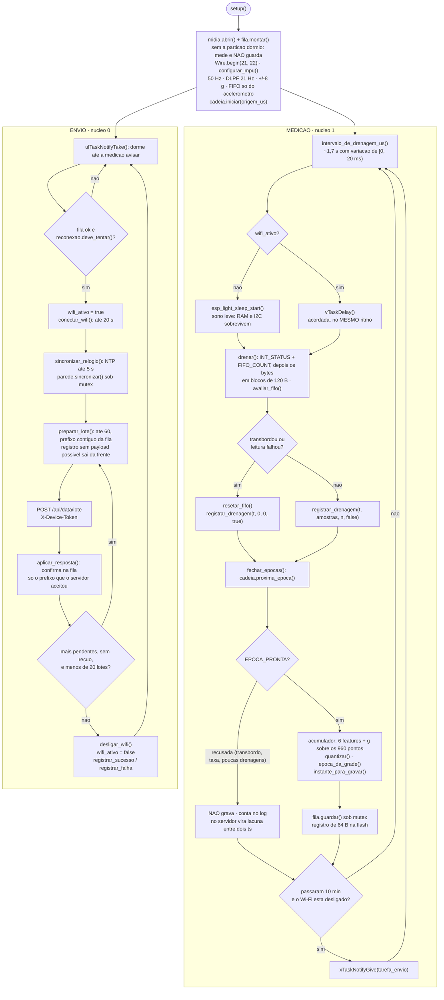
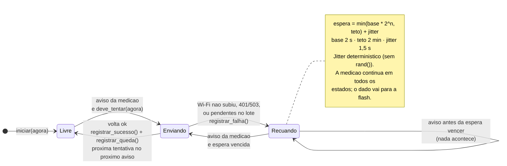
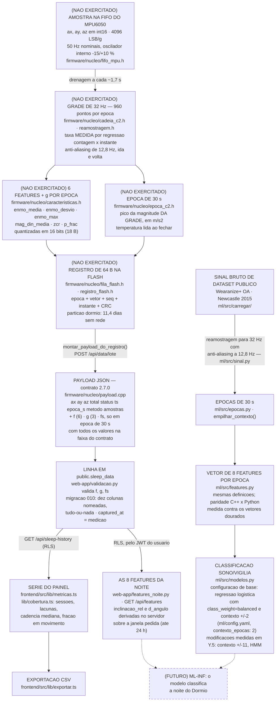

# DIAG-03 — Firmware: as duas tarefas, a política de rede e as transformações do dado

> **Item do backlog:** `DIAG-03` ("fluxograma do firmware / máquina de estados"), ampliado
> para cobrir também os pontos em que o dado muda de forma (amostra → grade → época de 30 s →
> features → classificação), que o backlog não pedia explicitamente.
> **Onde entra no TCC:** capítulo de Desenvolvimento, seção de firmware (figuras A e B)
> e seção de tratamento do dado (figura C). A figura C também serve ao capítulo de
> Metodologia, como ponte para os resultados de ML.
> **Estado do código:** ✏️ **reescrito em `2026-10-31`** para a arquitetura C2 (`ARQ-01`,
> `FW-07`, `FW-08`). Até 30/10 as figuras A e B descreviam o `envio-continuo.ino`, porque o
> `sketch.ino` de produto tirava uma amostra por boot; desde 31/10 o `sketch.ino` é o da C2, e é
> ele que as figuras descrevem. Os identificadores das três figuras foram conferidos contra o
> código em 31/10 por script, com controle positivo.
> ⚠️ **Nada do `sketch.ino` rodou na placa.** Ele compila e liga com o núcleo no host
> (`make sintaxe`); o núcleo que ele usa é testado no host. A figura A descreve o código, não um
> comportamento medido (`FW-07` (c)).
> O `envio-continuo.ino` continua no repositório como instrumento de bancada e sketch do Wokwi;
> o laço dele, que estas figuras mostravam até 30/10, está no histórico do git.

Convenções de leitura: ver `DIAG-01`.

---

## A — As duas tarefas do `sketch.ino` (C2)

A propriedade que o diagrama existe para mostrar: **a medição nunca espera pela rede**. Ela
roda no núcleo 1 e esvazia a FIFO do sensor no mesmo ritmo com o Wi-Fi ligado ou desligado; o
envio roda no núcleo 0 e só é acordado por ela.

**Por que a medição não dorme com o Wi-Fi ligado.** O sono leve desliga o rádio e derrubaria a
conexão no meio do envio. A FIFO do MPU guarda 3,4 s e é esvaziada a cada 1,7 s; um POST por
HTTPS leva de 1 a 3 s. Por isso a medição espera **acordada** enquanto o envio está no ar, e é
o fato de ela estar em outro núcleo que impede a FIFO de transbordar. Nada disso foi medido: é
o desenho, e a sessão de bancada (`FW-07` (c)) é que diz se ele se sustenta.

**Onde a época recusada entra.** Uma época que a cadeia recusa (FIFO transbordada, taxa medida
fora de ±20 %, drenagens de menos) **não é gravada**. No banco ela aparece como o intervalo entre
dois `ts`, que é o que ela é. Diferente do `envio-continuo`, onde a lacuna ocupa um registro
vazio no buffer: na flash o tempo de cada registro é gravado com ele, e a lacuna não precisa de
marcador.

---

## B — A política de reconexão (`firmware/nucleo/reconexao.h`)

A máquina de estados responde a uma pergunta só — "já posso tentar?" — e **nunca espera**: a
espera vira consulta a relógio. No `sketch.ino` ela é consultada a cada aviso da medição (de 10
em 10 min); uma volta de envio que termina bem libera a próxima de imediato, e uma que falha
afasta a próxima pelo recuo exponencial.

---

## C — Onde o dado muda de forma

Cada seta é uma transformação. O texto do TCC deve poder apontar para o arquivo que a
executa — por isso os nomes estão no diagrama.

## O ponto que este diagrama existe para deixar claro

Até 30/10 havia **duas cadeias de transformação que não se tocavam**: a do produto ia de amostra
a rótulo por limiar fixo, e a da pesquisa ia de dataset público a 8 features e classificador.
✏️ **Desde 31/10 as duas se encontram no código:** o dispositivo calcula as mesmas 6 features
que o `ml/`, com paridade medida contra os vetores dourados; o servidor as grava e deriva as
outras duas sobre a noite (`GET /api/features`), na mesma ordem que o modelo consome.

O que **não** mudou, e precisa estar dito no mesmo parágrafo:

- **Nenhuma época real percorreu a cadeia.** Tudo o que está marcado `(NÃO EXERCITADO)` roda no
  host, testado, e nunca na placa: o MPU6050 ainda não foi soldado (Etapa 0).
- **O classificador continua fora do produto.** O rótulo `status` que chega ao banco é limiar
  fixo (`|total − 9,81| > 1,2 m/s²`, `firmware/nucleo/payload.h`). A seta para o `ML-INF` é
  projeto.

Afirmar na banca que "o Dormio usa aprendizado de máquina para classificar sono" seria falso
hoje. O que é verdade é que o dispositivo produz, por construção, o vetor que o modelo consome,
e que o pipeline de ML mediu o custo da decisão de posicionamento do sensor que o Dormio adota.
