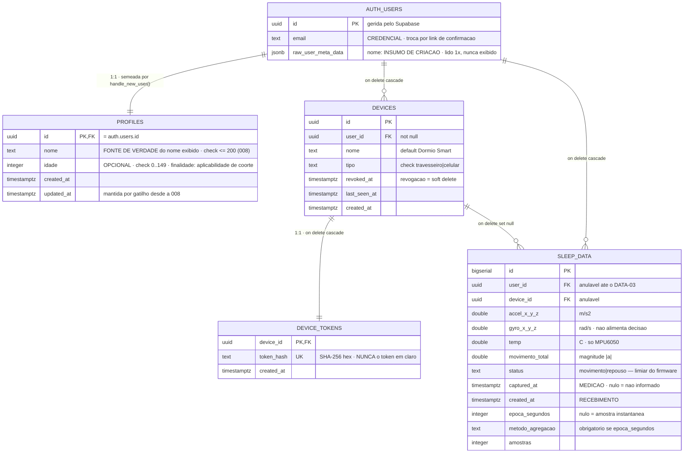
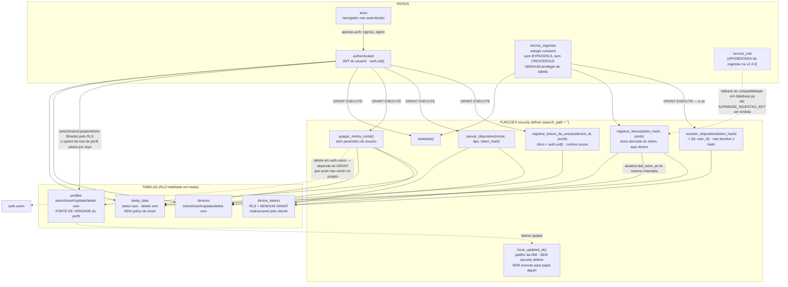
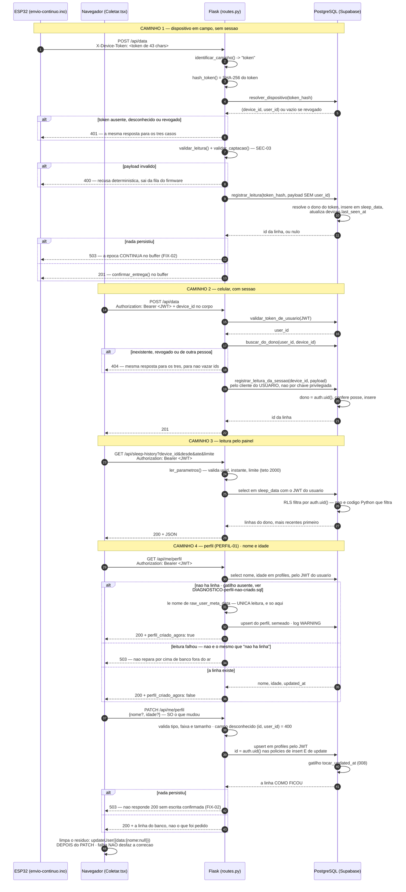

# DIAG-04 — Modelo de dados, sequência autenticada e privilégio

> **Item do backlog:** `DIAG-04` ("diagrama de sequência do fluxo autenticado + modelo ER
> com `devices` e `profiles`"), ampliado para cobrir também RLS e privilégio mínimo —
> o backlog foi levantado antes de `SEC-06`/`SEC-07` fecharem. É também a parte pendente
> do `DOC-05`.
> **Onde entra no TCC:** capítulo de Desenvolvimento, seção de persistência e segurança
> (figuras A e B) e seção de autenticação (figura C). A figura B é o que sustenta a
> seção de conformidade com a LGPD.
> **Estado do código:** verificado em `2026-09-29` e **revisado em `2026-10-17`**, após
> as migrações `001` a `008`.
> **Migrações escritas e NÃO executadas no Supabase:** a `002` (backfill do dono, item
> `DATA-03`) e a **`008`** (`PERFIL-01`). Os dois diagramas abaixo descrevem o esquema
> **com a `008` aplicada** — ver a nota ao fim da figura A para o que muda enquanto ela
> não rodar.

> ✏️ **O que o `PERFIL-01` mudou aqui, e por que este diagrama era o motivo de decidir
> antes.** O item dizia: *"decidir antes do `DIAG-04`: o modelo ER é material de banca, e
> um diagrama que mostra `profiles` com `nome` e `idade` documenta como projeto uma
> tabela cujas colunas nada lê."* Era isso. O ER de 29/09 desenhava `profiles.nome` e
> `profiles.idade` como se fossem dado do sistema; `nome` era cópia escrita uma vez pelo
> gatilho do signup e lida por nada, e `idade` estava vazia para todos os titulares. O
> diagrama não estava errado sobre o **esquema** e estava errado sobre o **projeto** — e
> a diferença só aparece para quem pergunta "quem lê esta coluna?", que é exatamente o
> que uma banca pergunta. Agora as duas colunas são lidas, e a figura A diz por quem.

Convenções de leitura: ver `DIAG-01`.

---

## A — Modelo entidade-relacionamento

**A decisão que o ER esconde se não for dita:** `token_hash` **saiu** de `devices` na
migração `007` e virou a tabela `device_tokens`. A razão é que `devices` é exposta ao
PostgREST, e `GRANT` de tabela no PostgreSQL alcança **toda** coluna — não existe revogar
uma coluna de um grant de tabela. Com a credencial em outra tabela, sem `GRANT` nenhum
para `anon`/`authenticated`, ela não é alcançável pelo cliente.

**O que ainda é anulável e por quê:** `sleep_data.user_id` e `device_id` nasceram
anuláveis porque as linhas coletadas antes da migração `001` não têm dono. O backfill
está escrito (`migrations/002_backfill_dono_dos_dados.sql`) e **não foi rodado** —
enquanto isso, o painel de uma conta nova nasce vazio (`DATA-03`).

**A decisão que o ER esconde se não for dita, nº 2: o nome existe em dois lugares, e só
um deles é lido.** `profiles.nome` é a fonte de verdade; `raw_user_meta_data.nome` é o
**insumo de criação** — o valor digitado no cadastro, lido uma vez pelo gatilho
`handle_new_user` para semear a linha de `profiles`, e depois disso lido por **nada**. A
duplicidade não é resolvida por sincronização: é resolvida por **leitor único** e
**destino único por campo** (nome e idade pela rota `/api/me/perfil`; e-mail pelo Auth,
porque é credencial). Um diagrama que mostrasse os dois campos de nome sem dizer qual
manda documentaria uma ambiguidade que o sistema não tem. O raciocínio inteiro está em
`docs/DECISAO-FONTE-DO-PERFIL.md`, e a regra do leitor único é catraca verificada em
`frontend/src/fonteDoNomeDoPerfil.test.ts`.

**A linha que falta no diagrama, e é de processo:** `profiles` pode **não ter linha** para
um usuário existente. Não é hipótese — `migrations/DIAGNOSTICO-perfil-nao-criado.sql`
existe porque já aconteceu (o gatilho não existia no projeto). Enquanto a tabela era
inerte isso era invisível; com ela canônica, `GET /api/me/perfil` **repara** a ausência,
semeando pelo metadado. Por isso o ER mostra a relação como `1:1` e o texto diz que ela é
*semeada*: o esquema garante no máximo uma linha, não que ela exista.

> ⚠️ **Enquanto a migração `008` não for aplicada:** o `check` de 200 em `nome` e o
> gatilho de `updated_at` **não existem no banco**, e `profiles.updated_at` continua
> congelado no instante da criação. A rota de perfil funciona sem a `008` — ela grava
> `nome` e `idade` pelas policies que existem desde a `001`. O que falta é o teto do
> caminho que não passa pelo Flask (o navegador fala direto com o PostgREST) e a
> honestidade da coluna de data.

---

## B — Quem alcança o quê, e com qual privilégio

O eixo do diagrama é: **nenhum caminho de escrita recebe o dono como parâmetro**.

**Verificação, não afirmação.** O que o diagrama diz sobre RLS é coberto por **146 testes**
contra um PostgreSQL real (`web-app/tests/rls/`), sem *mock*, incluindo invariantes de
catálogo (tabela nova sem RLS, `using (true)`, policy para `anon`). A suíte foi verificada
por mutação: **30 sabotadores** introduzidos, todos detectados
(`tests/rls/verificar_por_mutacao.py`). *(Eram 105 testes e 18 sabotadores em 29/09.)*

**Dois achados de 17/10 que mudam o que esta figura pode afirmar, e os dois vieram da
verificação por mutação, não da leitura:**

1. **`create function` concede `EXECUTE` a `PUBLIC` por padrão no PostgreSQL.** A
   migração `008`, ao criar `tocar_updated_at()`, **ampliava** o que o papel
   `dormio_ingestao` podia executar — o papel que a `005` existe para manter com
   `EXECUTE` em exatamente três funções. Quem acusou foi
   `test_o_papel_executa_exatamente_tres_funcoes`, na primeira execução da migração.
   Daí o `revoke` na `008` e o `F7` do diagrama dizer *"sem execute para papel algum"*:
   gatilho não precisa de `GRANT` para disparar, porque o privilégio é conferido na
   criação do gatilho.
2. **`test_ana_nao_cria_profile_para_o_bruno` barrava pela chave estrangeira, não pela
   policy.** Ele usava um uuid inventado, que não existe em `auth.users`. Passava com
   `profiles_insert_own` escancarada — medido. Corrigido com uma terceira usuária real
   **sem perfil**, que é o único cenário em que a policy de `insert` fica sozinha no
   caminho. E o par de `upsert` mostrou que **dois barramentos em série escondem um ao
   outro**: o teste da vítima *com* perfil não detecta policy de `insert` larga, porque a
   de `update` recusa primeiro.

**O caso de borda honesto do `apagar_minha_conta()`:** `auth.users` pertence ao Supabase, e
o `GRANT DELETE` nela pode não existir no projeto. Quando não existe, os dados de sono,
dispositivos e perfil são apagados e a rota responde `conta_de_acesso_removida: false` com
aviso. Isso é pendência de conformidade registrada em log como `WARNING`, não sucesso
silencioso.

> ✏️ **Correção de 2026-10-17.** Esta linha dizia *"a tela que exerce esse direito ainda
> não existe (`UI-10`): hoje só há a rota `DELETE /api/me`"*. A tela existe desde
> 17/10 — e o componente desde 29/09, sem que nenhum arquivo versionado o importasse,
> que é a história do `UI-10` e a ocorrência 4 do §6 das lições. **Este arquivo era o
> quarto a carregar uma afirmação desatualizada sobre aquela tela** — a entrada de 17/10
> (iii) do diário reporta três (backlog, `LGPD-ELIMINACAO.md` e a política), e esta
> passou. Achada por varredura própria ao fechar o `PERFIL-01`, com os termos *"ainda não
> existe"*, *"não há tela"* e *"existe como rota"* em `docs/`, `*.md`, `frontend/src/` e
> `web-app/`. A mesma varredura achou outras duas, em `CLAUDE.md`.

---

## C — Sequência do fluxo autenticado

Dois caminhos de ingestão e um de leitura. O `user_id` nunca vem do corpo da requisição
em nenhum deles.

**Por que o caminho 4 tem um `GET` que escreve, dito aqui porque é o que mais surpreende
quem lê o diagrama:** `profiles` pode não ter linha para um usuário que existe, e isso já
aconteceu neste projeto. Com a tabela canônica, linha ausente deixou de ser detalhe de
esquema e passou a ser nome em branco na tela de quem digitou o nome no cadastro. O
reparo é **idempotente**, que é a propriedade que de fato importa num `GET`.

**E por que a limpeza do resíduo está no navegador, e não no Flask:** `updateUser` age
sobre a **sessão** de quem chama, e o cliente do Flask só autentica o PostgREST. Fazer
isso no servidor exigiria a API de administração — papel privilegiado, recusado pelo
`SEC-06`. O navegador é o único lugar onde essa escrita acontece com a credencial do
próprio titular.

**O pareamento, que antecede tudo isso:** `POST /api/devices` gera um token aleatório,
guarda apenas o SHA-256 em `device_tokens` via `parear_dispositivo()` e devolve o token em
claro **uma única vez**. Não há caminho de recuperação — perdido o token, repareia-se o
dispositivo. A revogação (`POST /api/devices/<id>/revogar`) é *soft delete*:
`devices.revoked_at` é preenchido e as funções deixam de resolver aquele token.
