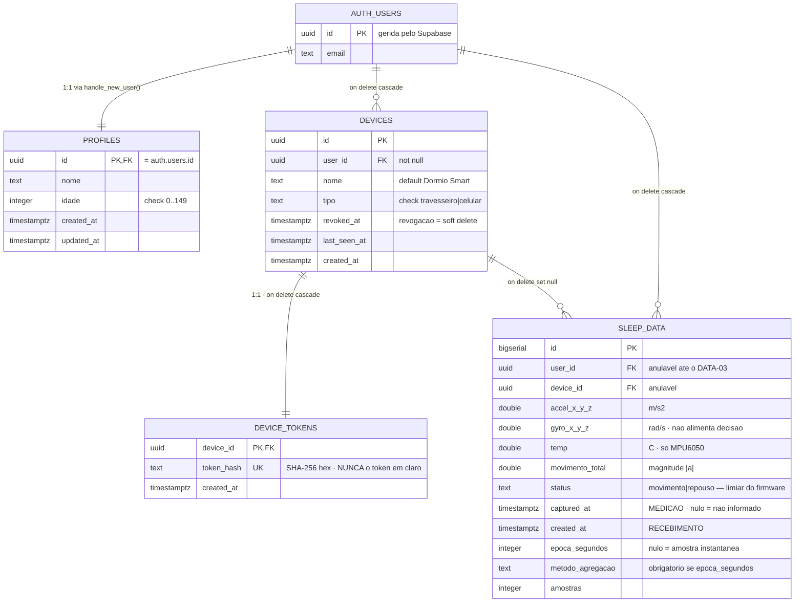
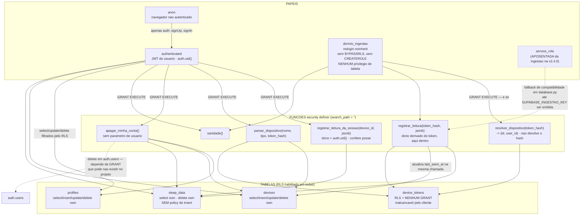
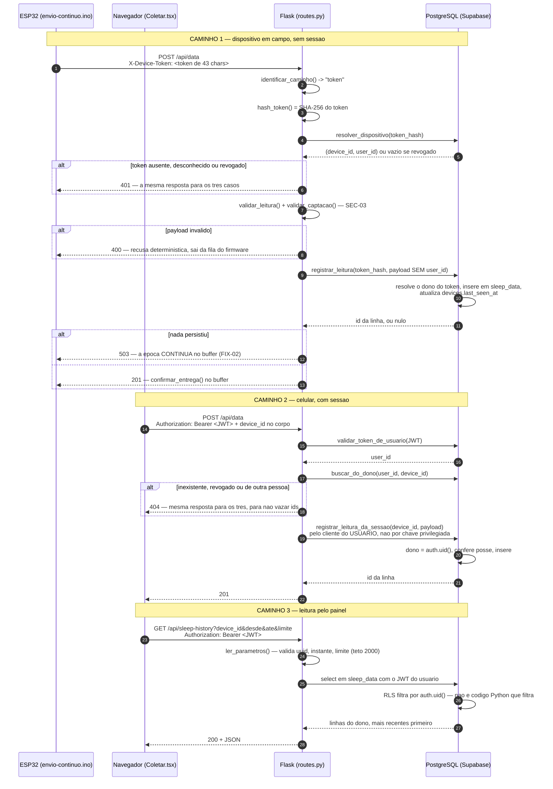

# DIAG-04 — Modelo de dados, sequência autenticada e privilégio

> **Item do backlog:** `DIAG-04` ("diagrama de sequência do fluxo autenticado + modelo ER
> com `devices` e `profiles`"), ampliado para cobrir também RLS e privilégio mínimo —
> o backlog foi levantado antes de `SEC-06`/`SEC-07` fecharem. É também a parte pendente
> do `DOC-05`.
> **Onde entra no TCC:** capítulo de Desenvolvimento, seção de persistência e segurança
> (figuras A e B) e seção de autenticação (figura C). A figura B é o que sustenta a
> seção de conformidade com a LGPD.
> **Estado do código:** verificado em `2026-09-29`, após as migrações `001` a `007`.
> A migração `002` (backfill do dono) **não foi executada no Supabase** — item `DATA-03`.

Convenções de leitura: ver `DIAG-01`.

---

## A — Modelo entidade-relacionamento

**A decisão que o ER esconde se não for dita:** `token_hash` **saiu** de `devices` na
migração `007` e virou a tabela `device_tokens`. A razão é que `devices` é exposta ao
PostgREST, e `GRANT` de tabela no PostgreSQL alcança **toda** coluna — não existe revogar
uma coluna de um grant de tabela. Com a credencial em outra tabela, sem `GRANT` nenhum
para `anon`/`authenticated`, ela não é alcançável pelo cliente.

**O que ainda é anulável e por quê:** `sleep_data.user_id` e `device_id` nasceram
anuláveis porque as linhas coletadas antes da migração `001` não têm dono. O backfill
está escrito (`migrations/002_backfill_dono_dos_dados.sql`) e **não foi rodado** —
enquanto isso, o painel de uma conta nova nasce vazio (`DATA-03`).

---

## B — Quem alcança o quê, e com qual privilégio

O eixo do diagrama é: **nenhum caminho de escrita recebe o dono como parâmetro**.

**Verificação, não afirmação.** O que o diagrama diz sobre RLS é coberto por 105 testes
contra um PostgreSQL real (`web-app/tests/rls/`), sem *mock*, incluindo invariantes de
catálogo (tabela nova sem RLS, `using (true)`, policy para `anon`). A suíte foi verificada
por mutação: 18 sabotadores introduzidos, todos detectados
(`tests/rls/verificar_por_mutacao.py`).

**O caso de borda honesto do `apagar_minha_conta()`:** `auth.users` pertence ao Supabase, e
o `GRANT DELETE` nela pode não existir no projeto. Quando não existe, os dados de sono,
dispositivos e perfil são apagados e a rota responde `conta_de_acesso_removida: false` com
aviso. Isso é pendência de conformidade registrada em log como `WARNING`, não sucesso
silencioso. **A tela que exerce esse direito ainda não existe** (`UI-10`): hoje só há a
rota `DELETE /api/me`.

---

## C — Sequência do fluxo autenticado

Dois caminhos de ingestão e um de leitura. O `user_id` nunca vem do corpo da requisição
em nenhum deles.

**O pareamento, que antecede tudo isso:** `POST /api/devices` gera um token aleatório,
guarda apenas o SHA-256 em `device_tokens` via `parear_dispositivo()` e devolve o token em
claro **uma única vez**. Não há caminho de recuperação — perdido o token, repareia-se o
dispositivo. A revogação (`POST /api/devices/<id>/revogar`) é *soft delete*:
`devices.revoked_at` é preenchido e as funções deixam de resolver aquele token.
