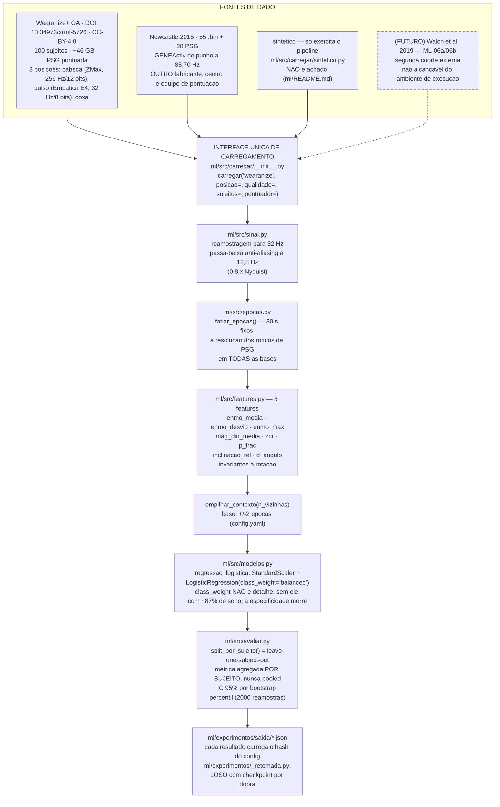
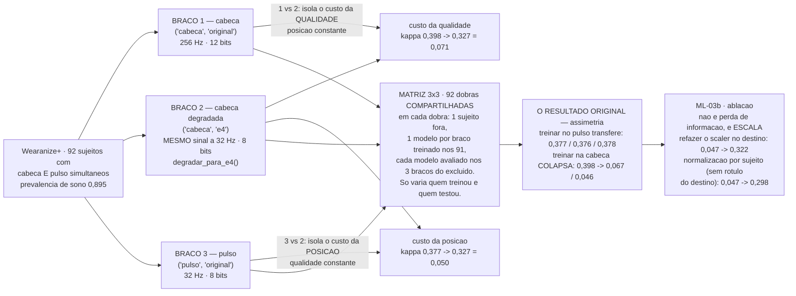
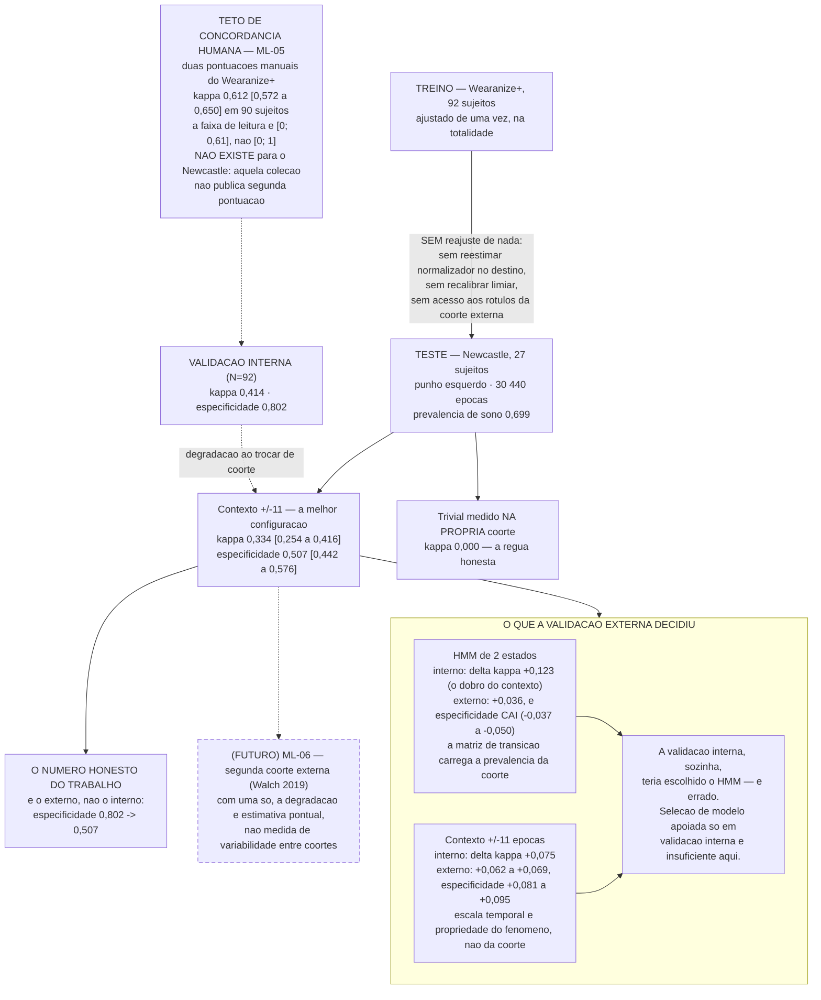

# DIAG-05 — Pipeline experimental de aprendizado de máquina

> **Item do backlog:** nenhum — este diagrama **nasce aqui**. O backlog foi levantado em
> `2026-09-10` e revisado em `22/09`, antes de o bloco de ML fechar (`ML-05` fechou em
> `28/09`), e por isso não previa uma figura para ele. O item `DIAG-02` do backlog
> (esquemático do circuito) continua aberto e **não** foi absorvido aqui — ver
> `README.md` desta pasta.
> **Onde entra no TCC:** capítulo de Metodologia, seção de procedimento experimental.
> É a figura que o leitor precisa ter à vista ao ler o capítulo de Resultados
> (`docs/RESULTADOS-TCC.md`, seções Y.2 a Y.7).
> **Estado do código:** verificado em `2026-09-29` contra `ml/src/`, `ml/experimentos/`
> e `ml/config.yaml` (`contexto_epocas: 2`, `epoca_s: 30`, `taxa_comum_hz: 32`,
> `seed: 20260910`, `validacao.estrategia: leave_one_subject_out`).

Convenções de leitura: ver `DIAG-01`.

---

## A — Do sinal bruto ao resultado

**A regra de validação que o diagrama codifica.** O agrupamento é sempre o **participante**.
Épocas da mesma noite são altamente correlacionadas; embaralhar por época infla a acurácia
de forma espetacular e falsa. Onde há registro bilateral, os dois punhos do mesmo
participante ficam sempre do mesmo lado da partição.

---

## B — Os três braços e a matriz de transferência (`ML-03`)

Os braços existem para separar duas variáveis que, com as duas posições originais, ficariam
confundidas: a **posição** do sensor e a **qualidade da grade de aquisição**.

---

## C — Validação externa e a conclusão metodológica (`ML-04`)

## O que este diagrama não autoriza a dizer

1. **Nada aqui foi medido no Dormio.** As três figuras descrevem experimentos sobre
   acelerometria de cabeça, punho e coxa de bases públicas. Nenhuma época do MPU6050
   entrou em nenhum deles — a Etapa 0 (solda) ainda não aconteceu.
2. **A posição "cabeça" do Wearanize+ é um sensor acoplado à cabeça, não apoiado no
   travesseiro.** O custo de posição de 0,050 em kappa é o custo da **posição anatômica**;
   o custo do **acoplamento mecânico através do travesseiro** permanece não medido, e é
   o que o `VIA-01` decide.
3. **`κ` das duas coortes não se comparam diretamente**: kappa depende da prevalência, que
   é 0,895 na base de desenvolvimento e 0,699 na externa. A leitura válida é cada um
   contra o trivial medido na própria coorte.
