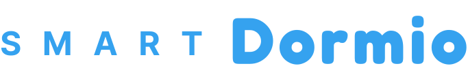
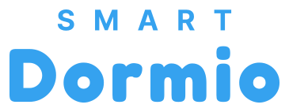
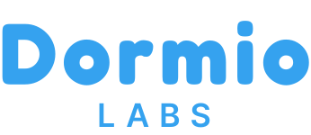
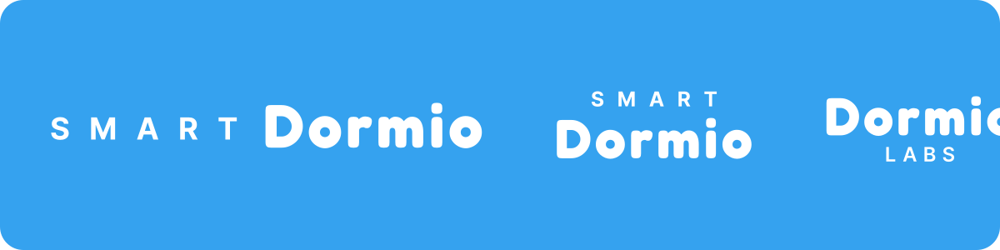
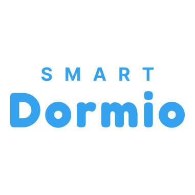
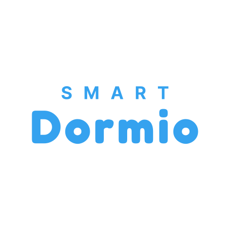
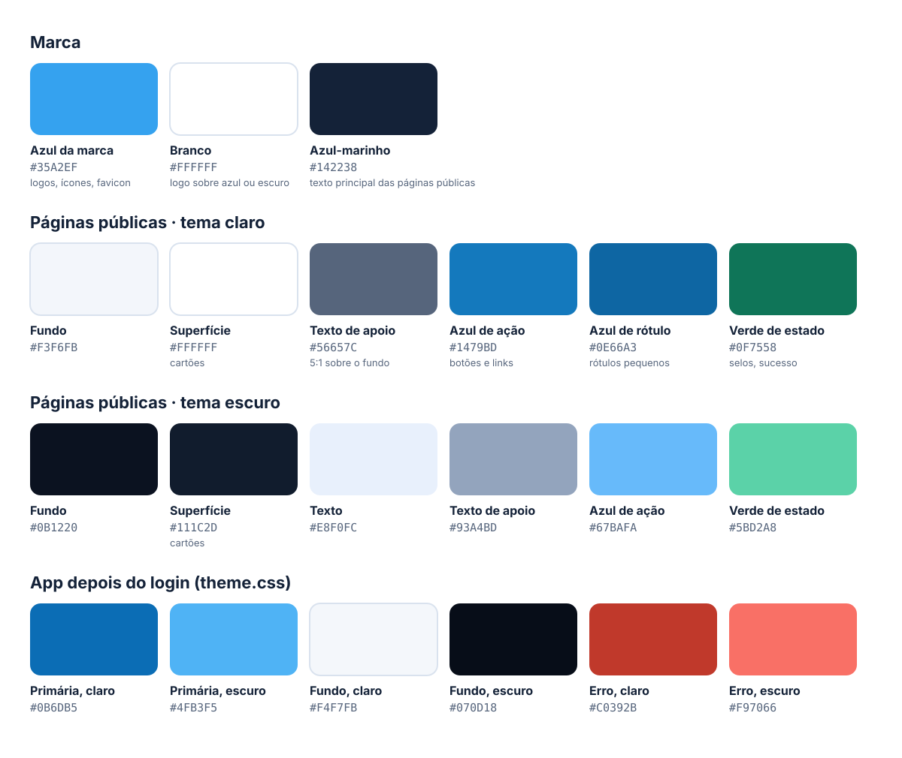

# Identidade visual — Smart Dormio

> **Criado em 2026-11-19 (`BRAND-04`).** Este é o manual da marca: os logos, os ícones, as
> cores e as regras de uso, com cada imagem num arquivo separado nesta pasta. A tipografia, a
> escala de tipos e os componentes das páginas ficam em
> [`docs/PADRAO-VISUAL.md`](../PADRAO-VISUAL.md). Antes de criar peça nova (post, slide,
> página, ícone), ler os dois.

## 1. A marca

| Nome | O que é | Onde aparece |
|---|---|---|
| **Smart Dormio** | O produto: o sensor no travesseiro e o app | Cabeçalho do site, ícone do app, materiais de divulgação |
| **Dormio Labs** | O laboratório que faz o produto | Assinatura no rodapé ("Desenvolvido na Dormio Labs") e o perfil @dormio.labs |

As duas usam **a mesma família de letras e o mesmo azul**. A Dormio Labs entra como assinatura,
nunca no lugar do produto.

## 2. Logos

Todos existem em **azul** (para fundo claro) e **branco** (para fundo azul ou escuro). Os SVGs são
vetoriais, para qualquer tamanho; os PNGs têm 1200 px de largura e fundo transparente, prontos para
redes sociais e slides.

### 2.1 Horizontal — o logo principal

"SMART" fino e espaçado ao lado de "Dormio" em negrito arredondado. É o logo do cabeçalho do site.
Usar quando houver largura: cabeçalhos, rodapés, capas, faixas.

| Versão | SVG | PNG |
|---|---|---|
| Azul | [`logos/smart-dormio-horizontal-azul.svg`](logos/smart-dormio-horizontal-azul.svg) | [`logos/smart-dormio-horizontal-azul.png`](logos/smart-dormio-horizontal-azul.png) |
| Branco | [`logos/smart-dormio-horizontal-branco.svg`](logos/smart-dormio-horizontal-branco.svg) | [`logos/smart-dormio-horizontal-branco.png`](logos/smart-dormio-horizontal-branco.png) |

### 2.2 Empilhado

"SMART" sobre "Dormio", nas mesmas proporções da Dormio Labs. "SMART" tem a altura de "LABS",
26,9 para os 71,6 de "Dormio", com o mesmo espaço entre as palavras. Usar em espaço quadrado ou
estreito: o ícone do app, o perfil de rede social, um adesivo.

| Versão | SVG | PNG |
|---|---|---|
| Azul | [`logos/smart-dormio-empilhado-azul.svg`](logos/smart-dormio-empilhado-azul.svg) | [`logos/smart-dormio-empilhado-azul.png`](logos/smart-dormio-empilhado-azul.png) |
| Branco | [`logos/smart-dormio-empilhado-branco.svg`](logos/smart-dormio-empilhado-branco.svg) | [`logos/smart-dormio-empilhado-branco.png`](logos/smart-dormio-empilhado-branco.png) |

### 2.3 Dormio Labs

| Versão | SVG | PNG |
|---|---|---|
| Azul | [`logos/dormio-labs-azul.svg`](logos/dormio-labs-azul.svg) | [`logos/dormio-labs-azul.png`](logos/dormio-labs-azul.png) |
| Branco | [`logos/dormio-labs-branco.svg`](logos/dormio-labs-branco.svg) | [`logos/dormio-labs-branco.png`](logos/dormio-labs-branco.png) |

### 2.4 As versões brancas, sobre o azul da marca

*Esta imagem é só uma prévia: as versões brancas têm fundo transparente e não aparecem sobre o
fundo branco desta página.*

## 3. Ícones

Duas marcas, cada uma onde se lê. Medido em 19/11: o texto não cabe na aba do navegador. Em 16 px
a marca empilhada vira uma faixa azul sem letra legível.

| | Ícone | Onde | Arquivos |
|---|---|---|---|
| **Ícone do app** |  | App instalado, tela inicial do celular, prévia de link | [`icone-app.svg`](icones/icone-app.svg), [`icone-app.png`](icones/icone-app.png) (1024 px) |
| **Ícone recortável do Android** |  | Android, que recorta o ícone num círculo de 80% | [`icone-app-maskable.svg`](icones/icone-app-maskable.svg), [`icone-app-maskable.png`](icones/icone-app-maskable.png) (1024 px) |
| **Favicon** |  | Aba do navegador | [`favicon-travesseiro.svg`](icones/favicon-travesseiro.svg), [`favicon-travesseiro.png`](icones/favicon-travesseiro.png) (512 px) |

- **O ícone do app** é a marca empilhada azul num quadrado branco cheio. O sistema arredonda os
  cantos sozinho; no iPhone, canto transparente sai preto.
- **O recortável** é a mesma marca com mais margem: a diagonal dela (360,9) cabe no círculo de 80%
  do quadrado (377,6 de 472).
- **O favicon** é um travesseiro com o traçado de movimento, branco sobre o azul da marca.
- **Os arquivos que o site usa** são gerados destes e ficam em `frontend/public/`:
  `favicon.ico`, `favicon-32.png`, `icone-192.png`, `icone-512.png` e `icone-maskable-512.png`
  (`PADRAO-VISUAL.md`, seção 7).
- **O app Android (APK)** ainda usa os ícones antigos: é o `APP-17`.

## 4. Cores

Arquivos: [`cores/paleta.svg`](cores/paleta.svg) e [`cores/paleta.png`](cores/paleta.png).

| Cor | Hex | Uso |
|---|---|---|
| **Azul da marca** | `#35A2EF` | Logos, ícones, favicon. **É a cor da marca**: logo nunca em outro azul. |
| Branco | `#FFFFFF` | Logo sobre o azul ou sobre fundo escuro |
| Azul-marinho | `#142238` | Texto principal das páginas públicas |
| Azul de ação | `#1479BD` (claro) · `#67BAFA` (escuro) | Botões e links das páginas públicas |
| Azul de rótulo | `#0E66A3` | Rótulos pequenos no tema claro (contraste) |
| Texto de apoio | `#56657C` (claro) · `#93A4BD` (escuro) | Parágrafos e notas; 5:1 sobre o fundo claro |
| Fundo | `#F3F6FB` (claro) · `#0B1220` (escuro) | Fundo das páginas públicas |
| Verde de estado | `#0F7558` (claro) · `#5BD2A8` (escuro) | Selos, sucesso, "em repouso" |

**O azul da marca (`#35A2EF`) não é cor de texto pequeno:** sobre o branco dá só 2,78:1 (o mínimo para texto é 4,5:1). Em logo e ícone, que são grandes e não são texto corrido, vale. Para texto
e botões, usar o azul de ação ou o de rótulo. As cores das páginas públicas vivem nos tokens
`--le-*` do `frontend/src/styles/theme.css`. O app depois do login tem a paleta própria (a última
linha da imagem), e alinhar as duas é o `UI-36`.

## 5. Tipografia

Resumo; o detalhe, medido, está em [`PADRAO-VISUAL.md`](../PADRAO-VISUAL.md):

- **Os logos são desenho, não texto digitado.** Usar sempre os arquivos desta pasta; nunca
  reescrever "Smart Dormio" numa fonte qualquer.
- **O texto das páginas públicas usa a fonte do sistema** (`ui-sans-serif, system-ui,
  -apple-system, "Segoe UI", sans-serif`): Segoe UI no Windows, San Francisco no Mac e no iPhone.
- **Pesos:** 400 texto, 800 botões, 850 títulos. **Mínimo de 11 px.**

## 6. Uso correto

**Fazer**
- Usar o logo azul sobre fundo claro e o branco sobre o azul da marca ou sobre fundo escuro.
- Deixar em volta do logo um espaço livre de, no mínimo, a altura do "D" de "Dormio".
- Respeitar os tamanhos mínimos: o horizontal com **120 px** de largura na tela (ou 30 mm
  impresso); o empilhado com **64 px** (ou 16 mm).
- Na aba e em tamanhos abaixo de 48 px, usar o favicon, não o logo.

**Não fazer**
- Esticar, achatar, girar ou inclinar o logo.
- Trocar a cor do logo, aplicar degradê, sombra ou contorno.
- Pôr o logo azul sobre o azul, sobre foto movimentada ou sobre fundo de pouco contraste.
- Separar "SMART" de "Dormio", ou mudar o espaço entre eles.
- Reescrever o nome com outra fonte, ou usar a marca empilhada em favicon.

## 7. Como os arquivos foram feitos, e como refazer

- **As letras vêm dos desenhos originais** do `frontend/public/smart-dormio.svg` e do
  `frontend/public/dormio-labs.svg`, sem redesenho. Os logos desta pasta recombinam esses traços:
  mudam a cor e, no empilhado, a posição.
- **Os PNGs** foram gerados abrindo cada SVG no navegador, no tamanho exato, com fundo
  transparente, e salvando a imagem. Para refazer: abrir o SVG, definir largura e altura, exportar
  em PNG (no Figma, no Inkscape ou no navegador) e trocar o arquivo aqui.
- **Mudou um logo ou ícone:** trocar o SVG e o PNG desta pasta, e regerar os arquivos do site
  (`frontend/public/`). Os testes de `frontend/src/padraoVisual.test.ts` conferem que o site
  declara e serve os ícones.

## O que este manual não cobre

| Lacuna | Por quê |
|---|---|
| **O ícone do app Android (APK)** | Ainda o antigo; é o `APP-17`. |
| **A fonte e a paleta do app depois do login** | Outfit e cores próprias; alinhar ou declarar a diferença é o `UI-36`. |
| **Modelos de post, slide e capa** | Não existem ainda; quando existirem, entram numa subpasta `modelos/`. |
| **Impressão** | Os tamanhos mínimos em milímetros são estimativa, não teste em papel. |
