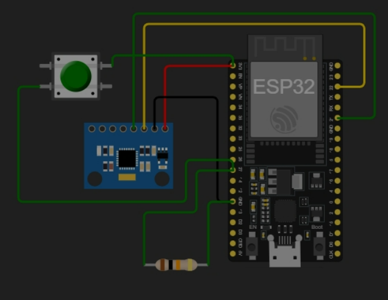

# Firmware — Smart Dormio (ESP32 + MPU6050)

O firmware lê o MPU6050 e envia os dados para a API web por HTTPS. Na arquitetura adotada em
30/10 (**C2**, [`ARQ-01`](../docs/DECISAO-ARQ-01-CADENCIA.md)), o ESP32 fica em **sono leve**,
lê em rajadas a memória interna (FIFO) do sensor a 50 Hz, calcula as features de cada época de
30 s, guarda as épocas numa fila na flash e envia em lote a cada 10 minutos.

> ⚠️ **Estado em 03/11/2026:** o `sketch.ino` da C2 **só foi compilado e ligado contra stubs**
> do Arduino, e o núcleo roda nos testes do computador ([`nucleo/`](nucleo/README.md)). **Nada
> disso rodou numa placa ainda** — espera a solda. ✏️ *03/11 (`DOC-15`): até aqui este README
> descrevia o firmware anterior (Deep Sleep, despertar por botão no GPIO 27, a flag
> `MODO_SIMULADOR`), que não existe mais em nenhum `.ino`.*

## Arquivos

| Arquivo ou pasta | Função |
|---|---|
| `sketch.ino` | **Firmware de produto**, arquitetura C2 (`FW-07` (b)): duas tarefas FreeRTOS — medição no núcleo 1 (sono leve, FIFO, features por época) e envio no núcleo 0 (lote a cada 10 min). **Só compilado e ligado com stubs; não rodou na placa.** |
| `nucleo/` | A lógica que não depende do Arduino (FIFO, cadeia C2, features, fila, lote, payload, reconexão), em C++ puro, **testada no computador** com `make`. Ver [`nucleo/README.md`](nucleo/README.md) |
| `nucleo_amalgama.cpp` | Traz o `nucleo/` para dentro do build do `sketch.ino` (a IDE só compila o que está na pasta do sketch) |
| `midia_flash_esp32.h` | A partição `dormio` da flash vista pela fila do núcleo (`FW-08`) — a única parte da fila que depende do ESP32 |
| `partitions.csv` | Tabela de partições com a `dormio` (2 MiB) para a fila |
| `ca_raiz.h` | ✏️ *(03/11, `SEC-15`)* As CAs raiz em que o firmware confia para o HTTPS (`setCACert`). **Canônico**; `envio-continuo/ca_raiz.h` é cópia idêntica, conferida por `scripts/conferir_tls_firmware.py` |
| `envio-continuo/` | Sketch de bancada **e do Wokwi**: lê e envia a intervalo fixo, sem dormir (ver abaixo) |
| `caracterizacao/` | Sketch de bancada: viés e escala de cada eixo (ver abaixo) |
| `diagnostico-i2c/` | Sketch de bancada: o barramento I2C está confiável? (ver abaixo) |
| `diagram.json` | O circuito no Wokwi (Fase 1) |
| `libraries.txt` | Bibliotecas do Wokwi |
| `secrets.example.h` | Modelo de credenciais — **copiar para `secrets.h`** |
| `secrets.h` | Credenciais reais — **ignorado pelo git, nunca versionar** |
| `sincronizar-secrets.sh` | Mantém as cópias do `secrets.h` iguais ao canônico (ver abaixo) |

## Credenciais (obrigatório antes de compilar)

O firmware não compila sem `secrets.h`. Isso é proposital: melhor falhar o build
do que compilar com credencial escrita no código, que é como segredo acaba no
histórico do git.

```bash
cp firmware/secrets.example.h firmware/secrets.h
# e preencha os três valores
```

| Macro | Fase 1 (Wokwi) | Fase 2 (placa real) |
|---|---|---|
| `WIFI_SSID` | `Wokwi-GUEST` | sua rede |
| `WIFI_PASSWORD` | vazio | sua senha |
| `DEVICE_TOKEN` | token do dispositivo pareado na aplicação | idem |

O **`DEVICE_TOKEN`** é gerado ao parear o dispositivo na aplicação e exibido uma
única vez (SEC-02). Sem ele, `POST /api/data` responde **401** e nada é gravado —
o monitor serial diz exatamente isso quando acontece.

> No Wokwi, `secrets.h` precisa ser criado **dentro do projeto do simulador**
> (aba de arquivos), já que o git não o traz junto. Ao gravar tela para o devlog,
> **não deixe essa aba aberta.**

## Pinagem

| Componente | Pino ESP32 | Função |
| :--- | :--- | :--- |
| MPU6050 VCC | 3V3 | Alimentação |
| MPU6050 GND | GND | Referência comum |
| MPU6050 SDA | GPIO 21 | Barramento I2C (dados) |
| MPU6050 SCL | GPIO 22 | Barramento I2C (clock) |

Na C2 o firmware só usa o I2C: o sono leve acorda por temporizador para esvaziar a FIFO, sem
pino de interrupção. O esquemático está em
[`docs/diagramas/DIAG-02-esquematico.py`](../docs/diagramas/DIAG-02-esquematico.py).

**O circuito do Wokwi (Fase 1)** ainda tem um **botão no GPIO 27 com pull-down de 10 kΩ**: era
o andaime de simulação do despertar por Deep Sleep do firmware anterior. Nenhum sketch atual o
usa; o `diagram.json` não foi alterado.



## Baixo consumo (nota honesta)

O ESP32 dorme em sono leve entre as rajadas, porque o sono leve preserva a RAM — e o buffer da
época precisa sobreviver (no Deep Sleep, não sobrevive; ver `nucleo/README.md`). O consumo
estimado da C2 está no [`ARQ-01`](../docs/DECISAO-ARQ-01-CADENCIA.md); **o medido não existe
ainda**. A placa **DevKit V1** mantém regulador e conversor USB-serial alimentados, o que pesa
em qualquer modo de sono; a medição e a avaliação de uma placa de menor consumo são da Fase 2.

## Como rodar

**Testes do núcleo, no computador** (precisa de `g++` e `make`; no Windows, em contêiner —
ver a seção "Testes" do [`CLAUDE.md`](../CLAUDE.md#testes)):
```bash
cd firmware/nucleo && make
```

**No Wokwi (Fase 1):** abra a pasta `firmware/` no [Wokwi](https://wokwi.com) com o sketch
`envio-continuo/` — o `sketch.ino` lê a FIFO do MPU, que o simulador pode não emular. Crie o
`secrets.h` no projeto (ver "Credenciais"). ⚠️ *Esta instrução não foi executada em 03/11: o
Wokwi não roda daqui. Os passos de antes (abrir com o `sketch.ino` e clicar no botão para
emular o despertar) eram do firmware anterior.*

**Na placa:** o `sketch.ino`, com a tabela de partições `partitions.csv`. Ainda não foi feito.

## `caracterizacao/` — instrumento de bancada (CALC-02)

Sketch separado que mede o viés e a escala de **cada eixo** do MPU6050 pelo método
clássico de 6 posições. **Não é firmware de produto:** não conecta Wi-Fi, não envia
nada e não dorme.

Está em pasta própria porque a IDE do Arduino concatena todos os `.ino` de uma mesma
pasta — dois `setup()` no mesmo build não compilam. A separação também garante que ele
não seja gravado no dispositivo por engano.

**Por que existe.** Uma medição real de bancada (2026-08-24) mostrou o sensor **parado**
marcando `|a| = 9,20 m/s²`, e não 9,81. O critério do projeto é `|total − 9,81| > 1,2`,
então o repouso já nasce com intensidade 0,61 — metade do orçamento do limiar gasta sem
ninguém se mexer, e com assimetria de 3,1× entre subir e descer.

Uma única orientação não distingue **erro de escala** (as 6 magnitudes saem parecidas e
baixas; corrige-se com um fator) de **viés por eixo** (as 6 variam; cada eixo precisa do
seu offset). O sketch mede as seis e calcula as duas coisas.

Uso: gravar, abrir o Monitor Serial a 115200 com "Nova linha", seguir as seis poses e
copiar o bloco entre as linhas de `=====`.

## `envio-continuo/` — fechar o laço de dados

Sketch de bancada que lê o MPU6050 e envia para a API num intervalo fixo, para sempre.
**Não dorme, não usa botão, não usa GPIO extra** — só 3V3, GND, SDA=21 e SCL=22.

✏️ *31/10: o `sketch.ino` foi reescrito para a C2 (`FW-07` (b)) e o parágrafo abaixo descreve
a versão anterior. O de hoje lê a FIFO do MPU, que o Wokwi pode não simular — por isso este
sketch continua sendo o da bancada e do simulador.*

**Por que não usar o `sketch.ino`.** Ele envia *uma* leitura e dorme esperando sinal no
GPIO 27, o que exige botão e pull-down de 10 kΩ. Sem eles o pino flutua e `digitalRead`
devolve ruído: ou a placa reinicia sozinha, ou nunca acorda. Não dá para testar o laço de
dados com essa variável solta.

O objetivo aqui é estreito: provar que a leitura sai do sensor, passa pela validação,
chega ao Supabase carimbada com o dono e aparece no painel.

**O dado vai cru.** O viés de hardware (`|a| = 9,20` em repouso nesta unidade) **não** é
corrigido aqui — a correção depende do `CALC-02`, e mascarar agora esconderia justamente o
que precisa ser medido. Em repouso a intensidade aparece perto de 0,6 no painel, e não de 0.

## `secrets.h` — um canônico, cópias descartáveis

O Arduino IDE 1.8.x **copia a pasta do sketch** para um diretório temporário antes de
compilar (é o `arduino_build_NNNNNN` do log). Arquivo de fora não vai junto, então
`#include "../secrets.h"` **não funciona**: o `..` do temporário não é o `..` do projeto.

Cada sketch precisa da sua cópia. A duplicação é imposta pela ferramenta, não é escolha.
O que dá para fazer é impedir que as cópias divirjam em silêncio — o que já aconteceu uma
vez, com a senha do Wi-Fi corrigida em apenas uma delas.

| | |
|---|---|
| `firmware/secrets.h` | **canônico** — edite este |
| `firmware/<sketch>/secrets.h` | cópias, descartáveis |

```bash
./firmware/sincronizar-secrets.sh              # canônico -> cópias
./firmware/sincronizar-secrets.sh --conferir   # só relata, não escreve
./firmware/sincronizar-secrets.sh --de <pasta> # promove uma cópia a canônico
```

**Se você editou uma cópia por engano** — fácil, é a que está aberta na IDE — o script
detecta que ela é mais nova, **aborta em vez de sobrescrever**, e sugere `--de <pasta>`
para promovê-la.

Duas garantias: nenhum valor de credencial é impresso (o terminal pode estar sendo
gravado), e o script recusa escrever em qualquer pasta que o `.gitignore` não cubra —
credencial versionada fica no histórico para sempre.

## `diagnostico-i2c/` — o barramento está confiável?

Fala **direto com os registradores** do MPU6050 pelo `Wire`, sem a biblioteca da Adafruit —
se a biblioteca fosse a suspeita, usá-la para investigar não provaria nada.

**Por que existe.** Em 25/08/2026 a bancada apresentou dois defeitos seguidos: primeiro
todos os registradores zerados (temperatura em 36,53 °C exatos), depois valores absurdos e
**instáveis** — `|a| = 56,5 m/s²` com a placa parada e ruído de 1,57 contra os 0,043 de um
sensor saudável. Erro de configuração daria valor errado porém *estável*; valor que pula
37× mais que o normal é corrupção de barramento.

Mede: varredura de endereços (3 passadas), `WHO_AM_I` mil vezes, bloco de 14 bytes mil
vezes com verificação de plausibilidade — tudo em 100 kHz e em 400 kHz.

| Resultado | Significa |
|---|---|
| 0 erros nas duas velocidades | barramento ok, o defeito é outro |
| erros só em 400 kHz | fio comprido ou pull-up fraco |
| erros nas duas | contato intermitente ou solda fria |
| nada responde na varredura | alimentação ou fio trocado |

Enquanto ele mede, **pressione cada fio e os pinos do header**. Se a contagem de erros mudar
com a pressão, o defeito é mecânico.
